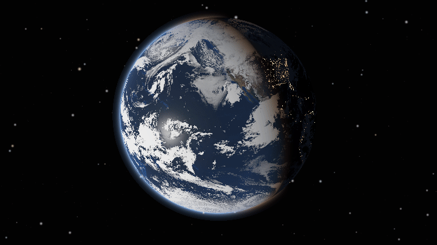
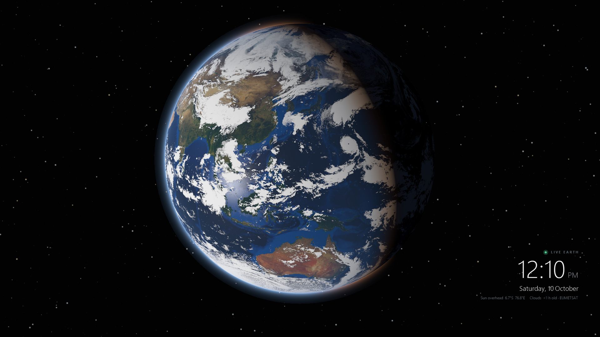
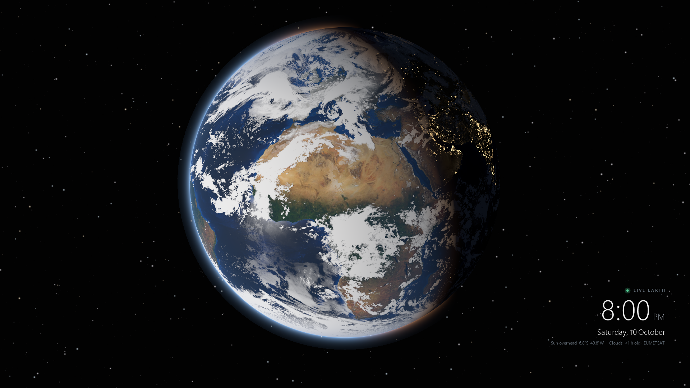

<div align="center">

# 🌍 Live Earth Wallpaper

**A real-time 3D Earth for your Windows desktop. Real sun, real day and night, live satellite clouds.**
**It uses about 0.2% CPU.**



<sub>24 hours in 5 seconds: the Earth turning under the Sun (the clouds stay frozen in this preview)</sub>

<br><br>

<a href="https://github.com/thefuturrjfhejh/live-earth-wallpaper/releases/latest"></a>


</div>

---

## ✨ What you get

| | |
|---|---|
| ☀️ **Real Sun position** | The day/night line is exactly where it is right now, accurate to the minute |
| 🌆 **Last night's real city lights** | Downloaded daily from NASA's VIIRS night satellites, so blackouts and new cities show up |
| ☁️ **Live clouds** | Real weather-satellite cloud cover, refreshed every 3 hours |
| 🌊 **Realistic look** | Sun glint on the oceans, cloud shadows, a blue atmosphere glow, orange sunset band |
| 🍂 **Seasons** | The land changes with the month: snow in winter, green in summer |
| 📍 **Your city** | Optional marker with today's sunrise and sunset times |
| 🧊 **Stays cool** | Draws one frame per minute, then sleeps. Pauses while you game or watch fullscreen video |

<p align="center">
  
  
</p>

---

## 🚀 Install (1 minute)

1. Go to **[Releases](https://github.com/thefuturrjfhejh/live-earth-wallpaper/releases/latest)** and download **`LiveEarth.zip`**.
2. Right-click the zip → **Extract All** → pick a folder you'll keep, for example `Documents\LiveEarth`.
3. Double-click **`LiveEarth.exe`**.

That's it. In a few seconds your wallpaper becomes the live Earth.

> **"Windows protected your PC"?** That happens because the app is new and not code-signed.
> Click **More info** → **Run anyway**. The full source code is in this repo if you want to check it or build it yourself.

### Make it start with Windows
Find the 🌐 globe icon in your taskbar tray (click the **^** arrow if you don't see it).
Right-click it and tick **Start with Windows**.

### Add your city (optional)
Right-click the tray icon → **Settings file...**, then fill in your city and coordinates:

```ini
place=Kolkata
lat=22.57
lon=88.36
```

To find your coordinates, right-click your city in Google Maps; the first line is `lat, lon`.
Save the file, then choose **Refresh now** from the tray menu.

---

## 🎛️ Tray menu

| Option | What it does |
|---|---|
| **Refresh now** | Redraw immediately |
| **View: Earth spinning under the Sun** | *(default)* Camera fixed relative to the Sun, so you watch continents roll from day into night |
| **View: Parked above my city** | Camera fixed over your city, so you watch day and night sweep across it |
| **Live clouds** | Turn the satellite clouds on or off |
| **Clock & info text** | Show or hide the clock in the corner |
| **Pause** | Stop updating |
| **Start with Windows** | Launch automatically when you log in |
| **Restore my old wallpaper & exit** | Put your previous wallpaper back and quit |

More settings, such as globe size and position, update interval and CPU limit, are in the settings file. Each one is explained there.

---

## 🧊 Why it won't heat your laptop

Most "live wallpapers" run a game engine or a web browser at 60 frames per second, all day.
At real speed the Earth turns only **0.25° per minute**, which is a pixel or two on your screen. So Live Earth:

- draws **one frame per minute** (about 0.3–0.8 s of work), then sleeps at 0% CPU
- runs at **lowest priority** with Windows 11's **EcoQoS** power-saving mode
- **skips frames** while you game, watch fullscreen video, present, or while the laptop is busy (over 75% CPU)
- uses no GPU and no background browser. It's one small `.exe` with no dependencies

Measured on an Intel i5-1035G1 laptop: **about 0.2% average CPU and about 140 MB RAM.**

---

## 🔬 How it works

There's no game engine. Live Earth contains its own small **ray tracer** written in C#:

1. Every minute it works out the Sun's exact position using astronomy formulas.
2. It places a virtual camera in space and traces a ray through each pixel to a 3D sphere.
3. Each point is lit physically: diffuse sunlight, reddened light near the terminator, a specular ocean glint, a cloud layer with shadows, city lights on the night side, and atmospheric scattering for the blue haze and glow at the edge.
4. The finished image is handed to Windows as the regular desktop wallpaper.

### Data sources
| Layer | Source | Updates |
|---|---|---|
| Land and ocean | [NASA Blue Marble Next Generation](https://visibleearth.nasa.gov/collection/1484/blue-marble) (monthly) | Changes with the month |
| City lights | Last night's [VIIRS Day/Night Band](https://www.earthdata.nasa.gov/data/instruments/viirs) passes (Suomi NPP + NOAA-20 + NOAA-21) via [NASA GIBS](https://www.earthdata.nasa.gov/engage/open-data-services-software/earthdata-developer-portal/gibs-api), with the cloud glow filtered out. Gaps are filled from [Black Marble 2016](https://earthobservatory.nasa.gov/features/NightLights) | **Daily** |
| Clouds and water mask | [Live Cloud Maps](https://github.com/matteason/live-cloud-maps) by Matt Eason, built from EUMETSAT data | **Every 3 hours** |

The textures (about 6 MB) download automatically on first run. After that, the cloud map refreshes every 3 hours (about 1.5 MB) and the night lights once a day (about 3 MB).

> **Honest note:** this is a physically accurate *model* of Earth right now, not a live photo. The sunlight and clouds are real-time,
> and the city lights are from **last night**: satellites photograph each place once per night, around 1:30 AM.
> The land surface is NASA's monthly average, so one-off events like a fresh snowstorm won't appear.
> Prefer the classic cloud-free look? Set `lights=2016` in the settings file.

---

## 🛠️ Build from source

You don't need Visual Studio or an SDK. Windows already includes the C# compiler.

```powershell
git clone https://github.com/thefuturrjfhejh/live-earth-wallpaper
cd live-earth-wallpaper
powershell -ExecutionPolicy Bypass -File build.ps1
.\LiveEarth.exe
```

Render a single frame or a time-lapse without touching your wallpaper:

```powershell
.\LiveEarth.exe --render earth.png --time 2026-12-21T12:00:00Z
.\LiveEarth.exe --timelapse frames --frames 48 --step 30 --size 960x540 --set showtext=off
```

---

## 🗑️ Uninstall

Right-click the tray icon → untick **Start with Windows** → **Restore my old wallpaper & exit**.
Then delete the folder.

---

<div align="center">
<sub>Contains modified EUMETSAT data · Earth imagery courtesy NASA Visible Earth / Earth Observatory · Built with Claude</sub>
</div>
